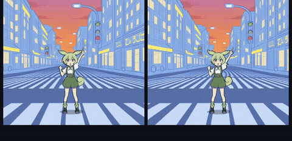
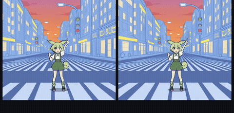
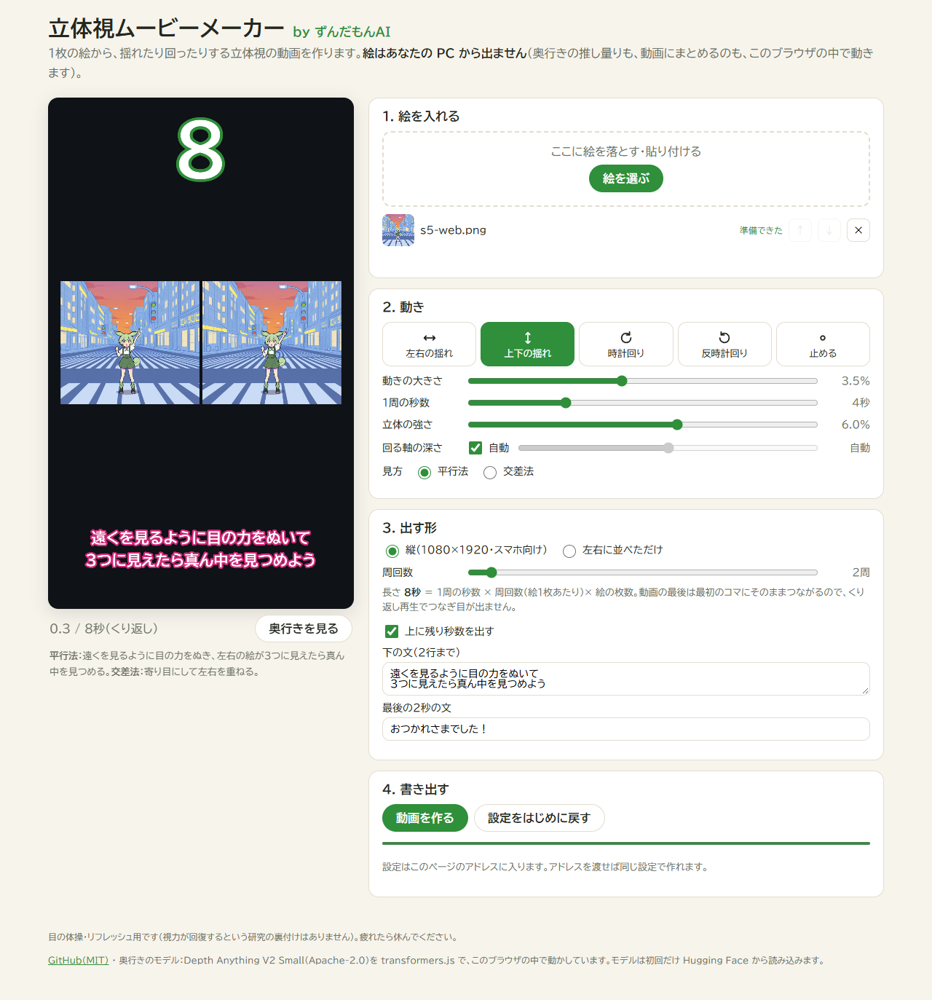

# 立体視ムービーメーカー by ずんだもんAI

**1枚の絵から、揺れたり回ったりする立体視（平行法・交差法）の動画を作る道具です。ブラウザだけで動きます。**

👉 **使う：https://tashirosmasashis-cell.github.io/stereo-motion/**

- 絵を入れて、動き（左右の揺れ・上下の揺れ・時計回り・反時計回り）を選び、その場で確かめてから MP4 に書き出せます
- **絵はあなたの PC から出ません**。奥行きの推し量りも、毎コマの描画も、動画にまとめるのも、開いたブラウザの中で動きます（サーバーはありません）
- 無料・登録なし・使った記録も取りません

| 左右の揺れ | 上下の揺れ | 時計回り | 反時計回り |
| :--: | :--: | :--: | :--: |
|  |  |  |  |



## 見方

- **平行法**：遠くを見るように目の力をぬき、左右の絵が3つに見えたら真ん中を見つめます
- **交差法**：寄り目にして左右を重ねます（画面で「交差法」を選ぶと左右が入れ替わります）

目の体操・リフレッシュ用です。視力が回復するという研究の裏付けは見つかっていません。疲れたら休んでください。

## できること

- **動き**：左右の揺れ／上下の揺れ／時計回り（カメラが右→下→左→上と円を描く）／反時計回り／止める
- **大きさ・1周の秒数・立体の強さ（左右のずれ）・回る軸の深さ**（はじめは絵の真ん中あたりの深さ＝人物のまわりを回る）
- **いつも永久ループ**：長さは「1周の秒数 × 周回数 × 絵の枚数」でしか決まりません。動画の最後のコマの次が最初のコマにそのままつながるので、くり返し再生してもつなぎ目が出ません
- **絵を何枚でも**入れられます。1枚ごとに決まった周回数を回り、ちょうど回り終えた所で次の絵に替わります
- **縦 1080×1920**（スマホ・ショート動画向け。上に残り秒数、下に2行の文、最後の2秒に締めの文）か、**左右に並べただけ**の形
- 設定はページのアドレスに入るので、アドレスを渡せば同じ設定で作れます
- 奥行きの絵を見る・確かめる

## しくみ

1. **奥行き**：[Depth Anything V2 Small](https://huggingface.co/onnx-community/depth-anything-v2-small)（Apache-2.0）を [transformers.js](https://github.com/huggingface/transformers.js) でブラウザの中で動かします（WebGPU、無ければ WASM）。モデル（約27MB）は初回だけ Hugging Face から読み込み、ブラウザに残ります
2. **下ごしらえ**：色の絵のふちに沿って奥行きを整え（ガイド付きフィルタ）、手前の物のふちを少し太らせ、手前の物を取り除いて背景で埋めた絵（隠れていた所の色）を作ります
3. **描画**：WebGL で、出す点ごとに奥行きに沿って光線をたどり、最初に当たる所を描きます。手前の物のふち（奥行きの崖）に当たったら、そこは動いて見えるようになった「隠れていた所」なので、背景の絵から描きます（引き伸ばしが出ません）
4. **書き出し**：同じ描き方で1コマずつ描き、WebCodecs と [Mediabunny](https://github.com/Vanilagy/mediabunny) で MP4 にまとめます（H.264 が作れないブラウザでは WebM）

考え方は [iw3（nunif）](https://github.com/nagadomi/nunif)・[DepthFlow](https://github.com/BrokenSource/DepthFlow)・[stable-diffusion-webui-depthmap-script](https://github.com/thygate/stable-diffusion-webui-depthmap-script) を参考にしました。ありがとうございます。

## AI から使う（MCP）

同じ描き方で、AI のエージェントからも動画を作れます。この PC の Chrome（か Edge）を見えない形で起こして同じ画面を動かすので、手で作った動画と同じ絵になります。絵はどこにも送りません。

```bash
git clone https://github.com/tashirosmasashis-cell/stereo-motion.git
cd stereo-motion
npm install
npm run build
claude mcp add stereo-motion -- node /path/to/stereo-motion/mcp/server.mjs
```

道具：

- `make_stereo_video`：絵のパス（1枚以上）と設定（`motion`・`amount`・`period`・`stereo`・`pivot`・`view`・`layout`・`cycles`・`countdown`・`caption`・`endText`。`seconds` を渡すと近い周回数に丸めます）から MP4 を作り、そのパスを返します
- `list_motions`：動きの種類とはじめの設定

コマンドで試す：`node mcp/cli.mjs --motion cw --cycles 2 --out out.mp4 image.png`

画面の書き出しが使えない環境では、毎コマの絵を受け取って [ffmpeg](https://ffmpeg.org/) でまとめます（ffmpeg が要ります）。

## 永久ループの検査

よくある凡ミス（最後のコマと最初のコマが同じ絵で、くり返すと同じ絵が2コマ続いてカクッと止まる）が起きていないことを、4つの動きで確かめます。

```bash
npm run build
npm run check:loop -- image.png
```

書き出した動画のコマ数がちょうど「1周×周回数×枚数」であること・描かない次のコマが最初のコマとまったく同じ（1周がぴったり閉じている）こと・最後のコマから最初のコマへの変わり方が、となり合うコマどうしと同じ大きさであることを見ます。

※ 動画の部品（WebCodecs）が無い古いブラウザでは画面を録画して書き出すので、コマ数がぴったりにならないことがあります（PC の Chrome・Edge・新しい Safari は部品があるのでぴったりです）。

## 手元で動かす

```bash
npm install
npm run dev
```

## ライセンス

MIT（このリポのコード）。奥行きのモデル Depth Anything V2 **Small** は Apache-2.0 です（Base・Large・Giant は商用不可なので使っていません）。Mediabunny は MPL-2.0、transformers.js は Apache-2.0、ONNX Runtime Web は MIT です。
